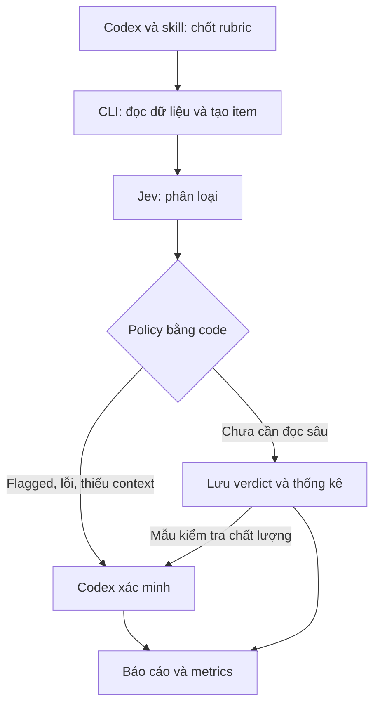

# Codex + Skill + Jev: kế hoạch project cá nhân và kiểm thử

**Project đề xuất:** `codex-jev-review-lab`  
**Ngày tổng hợp:** 11/10/2026  
**Đối tượng:** Long — lập trình viên .NET, muốn chuyển workflow Jev từ Oh My Pi sang Codex.  
**Trạng thái:** Tài liệu thiết kế và lộ trình. Chưa tạo repository, triển khai code hay chạy benchmark. Các lệnh `jev-review` bên dưới là giao diện dự kiến sẽ xây, không phải lệnh đã có sẵn.

## 1. Mục tiêu và lựa chọn ban đầu

Xây một project cá nhân để kiểm chứng workflow:

> Codex nhận yêu cầu review → skill gọi CLI → Jev phân loại diff → policy chọn mục cần kiểm tra → Codex xác minh → xuất báo cáo và metrics.

Chọn **Codex + skill + .NET CLI gọi Jev API** cho bản đầu. Sau khi CLI ổn định, bổ sung MCP dùng chung logic. CLI giúp quan sát input/output và debug; MCP giúp agent gọi các thao tác có cấu trúc.

Mục tiêu cần chứng minh:

- Workflow chạy được cả offline bằng dữ liệu giả lập và online bằng Jev thật.
- Agent chính không phải đọc toàn bộ dữ liệu thô trước khi phân loại.
- Không bỏ rơi item bị lỗi, quá lớn hoặc thiếu context.
- Findings cuối có bằng chứng và phân biệt kết quả model với kết quả đã xác minh.
- Đo được chất lượng, thời gian và chi phí so với Codex review trực tiếp.

Bản đầu chỉ đọc và báo cáo. Chưa cần Web API, Angular, database, Redis, nhiều agent hoặc tự động sửa/merge code.

## 2. Nền tảng từ Oh My Pi và Codex

### 2.1. Các magic keyword

| Keyword OMP | Ý nghĩa | Hướng chuyển sang Codex |
| --- | --- | --- |
| `ultrathink` | Hướng dẫn suy luận kỹ và điều chỉnh effort khi phù hợp | Cấu hình reasoning được model/client hỗ trợ |
| `orchestrate` | Chia việc độc lập, tổng hợp và xác minh | Skill yêu cầu subagents khi cần |
| `workflowz` | Điều phối workflow qua kernel, pool, handle | Runner/SDK khi cần quản lý job phức tạp |
| `jevify` | Phân loại hàng loạt trước, đọc sâu các mục bị đánh dấu | Skill + CLI/MCP + Jev |

Magic keyword kích hoạt hướng dẫn; runtime mới cung cấp công cụ. Copy chữ `jevify` vào Codex không tự tạo `judge()` hay `judge_batch()`.

Quy trình quan trọng của `jevify`: chốt rubric trước khi đọc bulk data; thu thập item bằng code; phân loại theo batch; xác minh các mục flagged; báo cáo số lượng và bằng chứng. Một lần gọi batch ở tầng agent không đồng nghĩa một HTTP request xử lý tất cả item.

### 2.2. Các khả năng Codex sẽ sử dụng

- Skill đặt tại `.agents/skills/jev-triage/SKILL.md`, gọi bằng `$jev-triage` trong CLI/IDE.
- Shell để chạy CLI của project.
- Công cụ đọc repo để xác minh findings.
- MCP hoặc Codex SDK là bước mở rộng sau.

Đặt tên skill là `jev-triage` để tránh nhầm với các project `jevify` chuyên chuyển lời gọi LLM trong ứng dụng sang Jev.

### 2.3. Repo tham khảo và phạm vi

| Nguồn | Vai trò tham khảo | Lưu ý |
| --- | --- | --- |
| `can1357/oh-my-pi` | Workflow rubric-first và escalation | Không copy nguyên helper API sang HTTP API |
| `ohmyjiro/jev-judge` | CLI Python nhỏ, gọi Jev và không echo input | Tham khảo adapter; không phải batch engine hoàn chỉnh |
| `PyModel/jev-judge-mcp` | MCP tích hợp Jev với coding agent | Có thể thử riêng; cần kiểm tra phiên bản và môi trường hỗ trợ |
| `Kevin-Zhouu/jevify` | Audit ứng dụng để tìm tác vụ phù hợp với Jev | Khác bài toán phân loại PR diff của project này |
| `Yeachan-Heo/oh-my-codex` | Workflow và orchestration quanh Codex | Chưa cần cho bản MVP |

Không mặc định thêm Jev sẽ nhanh hoặc rẻ hơn. Hiệu quả phụ thuộc kích thước dữ liệu, tỷ lệ escalation và overhead của toàn pipeline.

## 3. Case demo đầu tiên

**Câu hỏi:** PR được mô tả là refactor; thay đổi nào có thể làm thay đổi business logic?

| Thay đổi mẫu | Nhãn kỳ vọng |
| --- | --- |
| Đổi tên biến local, giữ nguyên biểu thức | `refactor_only` |
| Tách method, giữ nguyên thứ tự và điều kiện xử lý | `refactor_only` |
| Thay `>` bằng `>=` trong validation số lượng | `behavior_change` |
| Đổi tên và đồng thời bỏ kiểm tra quyền | `mixed` |
| Thay lời gọi method nhưng thiếu implementation liên quan | `insufficient_context` |

Diff từng file là đơn vị khởi đầu. Mỗi item kèm mục tiêu PR và context cần thiết. Khi cần suy luận xuyên file, trả `insufficient_context` và để Codex kiểm tra caller/implementation; không ép model kết luận từ diff thiếu dữ liệu.

## 4. Kiến trúc và trách nhiệm



| Thành phần | Trách nhiệm |
| --- | --- |
| `AGENTS.md` | Hướng dẫn build/test và quy tắc repo |
| Skill | Trình tự workflow, điều kiện sử dụng, định dạng báo cáo |
| Collection | Đọc fixture hoặc Git diff; tạo ID và input hash |
| Judge client | Gọi fake/live backend; validate response |
| Runner | Giới hạn concurrency, timeout, retry, trạng thái |
| Policy | Quyết định item nào cần xác minh |
| Codex | Đọc source/caller/test, xác nhận hoặc bác bỏ verdict |
| Evaluator | Đọc đáp án riêng, tính metrics sau khi inference kết thúc |

Jev API nhận `state` và `questions`, trả `answers`. HTTP API dùng `choice`, `noul`, `score`; helper `bool` trong OMP không phải tên type của HTTP API. MVP chỉ cần `choice`.

## 5. Cấu trúc project đề xuất

| Đường dẫn | Nội dung |
| --- | --- |
| `README.md` | Cài đặt, demo, đọc kết quả |
| `AGENTS.md` | Hướng dẫn cho Codex |
| `.agents/skills/jev-triage/SKILL.md` | Workflow review bằng Jev |
| `src/JevReview.Cli/` | .NET console app |
| `tests/JevReview.Tests/` | Unit và integration test offline |
| `rubrics/refactor-review.v1.json` | Nhãn và tiêu chí đã version hóa |
| `schemas/verdict.schema.json` | Hợp đồng output của project |
| `datasets/dev/` | Input dùng phát triển |
| `datasets/holdout/` | Input dùng đánh giá cuối |
| `scripts/` | Script demo và đánh giá |
| `docs/experiment-plan.md` | Quy trình benchmark |
| `runs/` | Output từng lần chạy, bỏ khỏi Git |

Đáp án gold cần đặt ngoài workspace inference hoặc bị chặn bằng cơ chế truy cập thực tế. Chỉ dặn agent “đừng đọc đáp án” không đủ để bảo đảm blind evaluation.

Trong console app có thể chia thư mục `Collection`, `Judging`, `Policy`, `Reporting`. Chưa cần tách thành nhiều class library. Chọn .NET SDK được hỗ trợ phù hợp máy và pin bằng `global.json` khi triển khai.

## 6. Chế độ chạy và CLI contract

### 6.1. Hai chế độ

| Mode | Hành vi | API key |
| --- | --- | --- |
| `fake` | Trả fixture xác định, hỗ trợ mô phỏng lỗi | Không |
| `live` | Gọi TypeSafe Jev API | Có |

Interface thiết kế:

```csharp
public interface IJudgeClient
{
    Task<JudgeResult> JudgeAsync(
        ReviewItem item,
        ReviewRubric rubric,
        CancellationToken cancellationToken);
}
```

Hai implementation: `FakeJudgeClient` và `JevJudgeClient`. DTO chi tiết sẽ được định nghĩa khi triển khai.

### 6.2. Lệnh dự kiến sẽ xây

```text
jev-review doctor
jev-review classify --dataset datasets/dev --mode fake
jev-review classify --dataset datasets/dev --mode live
```

`doctor` kiểm tra config, đường dẫn và sự hiện diện của credential, không in API key. Kiểm tra kết nối live là tùy chọn riêng, có thể phát sinh phí. Lệnh này không liên quan tới lệnh `doctor` của các repo upstream.

M1 chạy tuần tự. Chỉ bổ sung bounded concurrency sau khi live call hoạt động và đã biết rate limit. Retry lỗi tạm thời có giới hạn; không retry lỗi authentication hoặc payload không hợp lệ như một lỗi mạng.

## 7. Dữ liệu, rubric và chống rò rỉ đáp án

### 7.1. Quy mô ban đầu

- M1: 4 case để kiểm tra pipeline, mỗi nhãn một case.
- M3: 20 case dev để chỉnh rubric/policy.
- M5: 20 case holdout chưa dùng để chỉnh hệ thống.

40 case là bộ pilot nhỏ, không đủ để tuyên bố chất lượng production. Chia theo nhóm thay đổi tương tự để tránh cùng một pattern gần như trùng lặp xuất hiện ở cả dev và holdout.

### 7.2. Input mẫu

```json
{
  "id": "case-001",
  "task": "Refactor validation without changing business behavior.",
  "path": "src/Orders/OrderValidator.cs",
  "diff": "<diff thực tế của case>",
  "context": "<context tối thiểu cần thiết>"
}
```

Đáp án riêng, chỉ evaluator được đọc:

```json
{
  "id": "case-001",
  "expectedLabel": "behavior_change",
  "reason": "Changes the quantity boundary from > to >=."
}
```

### 7.3. Rubric

| Nhãn | Định nghĩa |
| --- | --- |
| `refactor_only` | Thay cấu trúc, giữ nguyên hành vi quan sát được |
| `behavior_change` | Thay đổi kết quả hoặc điều kiện xử lý |
| `mixed` | Có cả refactor và thay đổi hành vi |
| `insufficient_context` | Chưa đủ bằng chứng để kết luận |

Ưu tiên `insufficient_context` nếu thiếu bằng chứng cần thiết; dùng `mixed` khi có phần refactor riêng và phần thay đổi hành vi riêng. Viết ví dụ biên trong rubric để các nhãn nhất quán.

Chốt rubric trước khi chạy bulk data. Đổi rubric tạo phiên bản/run mới. Nếu chỉnh theo kết quả holdout, tập đó trở thành dữ liệu phát triển và cần holdout mới.

## 8. Policy và output

| Điều kiện | Hành động |
| --- | --- |
| `behavior_change` hoặc `mixed` | Codex xác minh |
| `insufficient_context` | Thu thập thêm context hoặc báo chưa kết luận |
| API lỗi hoặc response sai schema | Ghi `unjudged`; không coi là pass |
| Input quá lớn | Chia có bảo toàn context hoặc chuyển review |
| `refactor_only` nhưng xác suất thấp | Codex xác minh |
| File thuộc phạm vi luôn review như authorization/transaction | Review bất kể nhãn |
| Mẫu từ nhóm không flagged | Kiểm tra chất lượng để phát hiện false negative |

Ngưỡng xác suất phải cấu hình và hiệu chỉnh bằng tập dev. Không coi con số model trả ra là bảo đảm đúng. Khi dùng xác suất nhãn, đọc trường probability tương ứng; không mặc định `confidence` bằng xác suất cao nhất.

Output mỗi run:

| File | Nội dung |
| --- | --- |
| `manifest.json` | Run ID, model thực tế, rubric hash, input hash, thời gian, cấu hình |
| `verdicts.jsonl` | Verdict từng item và trạng thái |
| `flagged.json` | ID và lý do cần đọc sâu |
| `errors.jsonl` | Lỗi và item chưa được đánh giá |
| `report.md` | Counts, findings, bằng chứng, giới hạn coverage |

Đối soát số lượng theo trạng thái cuối loại trừ nhau:

```text
total = classified + failed_or_unjudged + excluded_with_reason
```

`flagged` là thuộc tính/nhóm cần kiểm tra, không cộng thêm vào công thức vì có thể là tập con của các trạng thái trên.

Lưu kết quả đã thành công để phục vụ resume ở giai đoạn sau. Khóa tái sử dụng phải gồm input hash, rubric hash và cấu hình/model; thay một yếu tố thì không dùng lại verdict cũ như kết quả của run mới.

## 9. Skill cho Codex

Skill `jev-triage` cần quy định:

1. Xác định nhiệm vụ và rubric trước khi tải bulk data vào context.
2. Gọi CLI đọc dữ liệu từ file và phân loại.
3. Chỉ đọc summary, flagged IDs và lỗi ở lượt đầu.
4. Mở source/context của item cần kiểm tra.
5. Xác minh bằng implementation, caller, test hoặc bằng chứng cụ thể.
6. Phân biệt verdict Jev với finding đã xác minh; ghi nhận verdict bị bác bỏ.
7. Báo cáo phần chưa được đánh giá và phạm vi chưa kiểm tra.

CLI không echo toàn bộ diff hoặc key ra stdout. Raw data lưu cục bộ theo policy; agent nhận báo cáo gọn. Đánh giá model không thay thế build/test.

## 10. Kiểm thử

| Tầng | Phạm vi | Chạy mặc định |
| --- | --- | --- |
| Unit | Policy, mapping ID, parser, đối soát counts | Có |
| HTTP integration giả lập | Timeout, 429/5xx, JSON sai, thiếu answer | Có |
| Live smoke test | Một request thật, kiểm tra schema/credential | Thủ công |
| Live evaluation | Bộ case có đáp án, metrics chất lượng và hiệu năng | Thủ công |

Checklist test quan trọng:

- [ ] Thiếu question ID không được đánh dấu thành công.
- [ ] Nhãn không thuộc rubric hoặc xác suất không hợp lệ được xử lý rõ.
- [ ] Item lỗi luôn có mặt trong output/counts.
- [ ] Retry có giới hạn, cancellation hoạt động.
- [ ] Input vượt giới hạn không bị cắt âm thầm.
- [ ] Fake và live có cùng output contract.
- [ ] Không in key hoặc payload nhạy cảm trong lỗi.
- [ ] Resume không dùng verdict cũ khi input/rubric/model đổi.

CI mặc định chạy offline. Live evaluation chạy chủ động để kiểm soát chi phí. Không chạy mã hoặc test tùy ý từ PR không tin cậy trong cùng môi trường giữ API key.

## 11. Thiết kế phép so sánh

| Workflow | Hành vi |
| --- | --- |
| A — Baseline | Codex review trực tiếp cùng tập input |
| B — Jev + Codex | Jev phân loại, policy chuyển flagged sang Codex |

Giữ cùng nhiệm vụ, input, model/cấu hình Codex và điều kiện môi trường. Dùng phiên mới cho mỗi run. Ghi nhận context bổ sung mà mỗi bên được phép truy cập. Đo lần đầu không dùng cache và tách riêng kết quả warm-cache nếu có.

### 11.1. Tầng lọc Jev

Xác định trước positive là item mà đáp án yêu cầu review sâu. Có thể báo cáo thêm riêng nhóm có thay đổi hành vi để không gộp mơ hồ với thiếu context.

- Recall = TP / (TP + FN): có bỏ sót item cần review không?
- Precision = TP / (TP + FP): flagged có đúng mục tiêu không?
- Escalation rate = số item chuyển review / tổng item.
- Error rate và coverage: có bao nhiêu item chưa có verdict hợp lệ?
- Confusion matrix của bốn nhãn.

Nếu mẫu số bằng 0, báo N/A, không tự gán điểm hoàn hảo. Công khai lỗi và denominator; không loại item lỗi để làm đẹp metrics.

### 11.2. Toàn pipeline

- Findings đúng/sai và vấn đề bỏ sót theo đáp án người kiểm tra.
- Tổng thời gian wall-clock: collection, Jev, retry, Codex verification, reporting.
- Latency Jev từng call và p50/p95; với tập nhỏ chỉ coi là thăm dò.
- Tổng token/chi phí của các thành phần khi đo được; thiếu thì ghi N/A.
- Số lượng hoặc kích thước dữ liệu vào context agent chính khi có thể quan sát.

Tập pilot đạt khi không mất item, truy lại được input/rubric, không bỏ sót case nghiêm trọng đã cài trong bộ thử và biết rõ B tốt/xấu hơn A ở điểm nào. Không coi kết quả pilot là bằng chứng tổng quát cho production.

## 12. Các mốc M1–M6

| Mốc | Công việc | Điều kiện hoàn thành |
| --- | --- | --- |
| M1 | Repo, console/test project, fake client, 4 case | Build/test offline; tạo báo cáo đủ 4 item |
| M2 | Jev client, credential, timeout, validate response | Một call thật trả output hợp lệ, không lộ key |
| M3 | 20 case dev, rubric, batch runner, policy | Đối soát đủ item; lỗi/flagged rõ; test lỗi pass |
| M4 | Skill `jev-triage` và Codex verification | Codex gọi CLI, đọc flagged và báo findings có bằng chứng |
| M5 | 20 holdout case, baseline và evaluator | Báo cáo A/B, metrics, false negatives và giới hạn |
| M6 | Git diff collector và MCP | Review Git range thật; CLI/MCP dùng chung logic |

Thứ tự triển khai: hoàn thành M1–M2 trước, sau đó M3–M4, cuối cùng M5 rồi quyết định mở rộng M6.

Khi thêm Git collector, ghi rõ base SHA/head SHA và semantics diff. Với PR, xác định có dùng merge-base với target branch hay không, lưu resolved SHAs; không âm thầm đổi phạm vi giữa hai lần đánh giá. Với working tree, ghi rõ có bao gồm staged/unstaged/untracked hay không.

## 13. MCP ở giai đoạn sau

| Tool đề xuất | Input/output chính |
| --- | --- |
| `start_review` | Dataset hoặc Git range + rubric → run ID |
| `get_review_status` | Run ID → tiến độ và counts |
| `get_review_result` | Run ID → verdict/flagged/report |

MCP adapter dùng chung collection, judge client và policy với CLI. Giới hạn đường dẫn vào workspace; không nhận chuỗi shell tùy ý. Với job dài, trả run ID và lưu tiến độ để có thể lấy kết quả sau.

Nếu ưu tiên thử công cụ sẵn có thay vì tự viết adapter, có thể pilot `PyModel/jev-judge-mcp` riêng. Không cần vừa tự xây MCP vừa cài nhiều framework trong MVP. Kiểm tra hướng dẫn upstream và pin phiên bản tại thời điểm cài đặt.

## 14. Checklist Long cần chuẩn bị

- [ ] Tạo repo GitHub `codex-jev-review-lab` và clone về máy.
- [ ] Xác nhận môi trường chạy: Windows native hoặc WSL2; giữ CLI/Codex cùng môi trường trong pilot.
- [ ] Kiểm tra `git --version`, `dotnet --info`, `codex --version`.
- [ ] Đảm bảo Codex đăng nhập và hoạt động.
- [ ] Tạo TypeSafe API key, lưu qua cơ chế secret cục bộ hoặc biến môi trường `TYPESAFE_API_KEY`.
- [ ] Không gửi API key vào chat, commit hoặc request fixture.
- [ ] Chốt ngân sách cho live smoke test/evaluation.
- [ ] Dùng code mẫu tự tạo hoặc dữ liệu được phép gửi tới dịch vụ ngoài.
- [ ] Tự kiểm tra nhãn gold, nhất là các case biên và thiếu context.
- [ ] Giữ gold labels tách khỏi môi trường inference.

## 15. Definition of Done của project pilot

- [ ] Người khác clone repo và chạy offline demo bằng README.
- [ ] Có đường chạy live rõ ràng với credential do người dùng tự cấu hình.
- [ ] Có skill được Codex nhận diện và sử dụng.
- [ ] Mỗi run có manifest, verdicts, flagged, errors và report.
- [ ] Tests kiểm tra các failure mode thực tế, không chỉ happy path.
- [ ] Có báo cáo A/B trên holdout, kể cả khi Jev không cải thiện kết quả.
- [ ] Có TODO rõ cho resume, Git collector, MCP hoặc CI mở rộng.
- [ ] Không tự động merge hay kết luận “an toàn” chỉ từ verdict của Jev.

## 16. Tài liệu tham khảo

Các nguồn đã đọc trong cuộc trao đổi; khả năng và hướng dẫn cài đặt có thể thay đổi. Khi triển khai, kiểm tra phiên bản thực tế và ghi lại commit/package version.

1. [Oh My Pi — Magic keywords](https://github.com/can1357/oh-my-pi/blob/main/docs/magic-keywords.md)
2. [Oh My Pi — Jevify notice](https://github.com/can1357/oh-my-pi/blob/main/packages/coding-agent/src/prompts/system/jevify-notice.md)
3. [TypeSafe — Jev API reference](https://docs.typesafe.ai/api)
4. [Codex — Build skills](https://developers.openai.com/codex/skills)
5. [Codex — Subagents](https://developers.openai.com/codex/multi-agent)
6. [Codex — SDK](https://developers.openai.com/codex/sdk)
7. [Codex — Non-interactive mode](https://developers.openai.com/codex/noninteractive)
8. [ohmyjiro/jev-judge](https://github.com/ohmyjiro/jev-judge)
9. [PyModel/jev-judge-mcp](https://github.com/PyModel/jev-judge-mcp)
10. [Kevin-Zhouu/jevify](https://github.com/Kevin-Zhouu/jevify)
11. [Yeachan-Heo/oh-my-codex](https://github.com/Yeachan-Heo/oh-my-codex)
