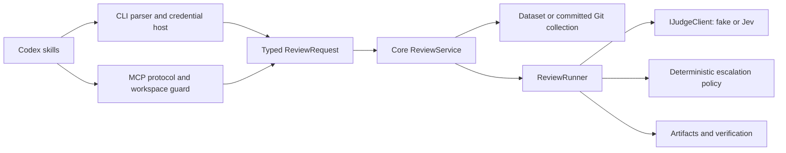

# Architecture and maintenance

## Boundaries

`JevReview.Core` contains review DTOs, source/request types, collection, judging, policy and reports. It depends only on the .NET framework. It receives live credentials as an explicit service argument; it does not read Console, environment credentials or CLI argument types. `ReviewRunner` receives `IJudgeClient` through its constructor so retry/accounting behavior can be verified without a network connection.

`JevReview.Cli` owns composition and environment credential lookup, command parsing, evaluation entry points and MCP stdio. CLI and MCP independently map inputs to `ReviewRequest`. MCP accepts structured JSON and enforces workspace bounds; it no longer converts JSON fields into CLI argument strings. Evaluation-specific gold DTOs remain in the host, separate from the inference core.

This small tooling application uses constructor injection and explicit composition. There is no service locator, dynamic plugin loader, database or separate workflow engine. A future host may compose a runner with another IJudgeClient, but v1 byte budgets still measure the current Jev request schema for consistent fake/live tests. New providers must define their budget contract before changing this behavior.

## Compatibility

CLI command names/options and serialized artifact fields, record property order, labels and accounting remain compatible. Shared labels belong to the core; the evaluator exposes the same values. The source-level service signature changes from `StartAsync(CommandOptions, ...)` to `StartAsync(ReviewRequest, ..., apiKey)`; direct source consumers must construct the typed request. Core is not a published NuGet API in v1.

Git uses resolved commit SHAs, no external diff/textconv, literal pathspec and UTF-8 subprocess streams. Working-tree changes are excluded. MCP remains the declared `2025-06-18` newline-delimited stdio subset; it is not a general MCP implementation or HTTP transport.

## Dead-code decisions

`Job.Task` was assigned only when dispatching work and never read; it was removed. The background task catches and records terminal status. The retained ReviewRun was reduced to the RunManifest because status/result paths only consume that manifest; verdict arrays are persisted and are not retained per completed job.

`Models.cs` was replaced by responsibility-specific review/judge/policy/run/verification/evaluation files. It was moved/split, not discarded as unused. Analyzer-confirmed redundant imports were removed. Serializer-populated DTO fields, public entry points and test helpers were kept: a missing text reference does not prove dead code for JSON, reflection and discovery.

`.editorconfig` and build settings enforce IDE0005, IDE0051, IDE0052 and IDE0060 with warnings as errors. XML output is enabled because IDE0005 requires it at build; CS1591 is excluded while narrative contract docs cover this internal API. This narrow exclusion preserves unused-code and nullable diagnostics. Format checks use `dotnet format whitespace ... --verify-no-changes` and focused analyzer verification.

## Operational limits

Predictions remain separate from reviewer evidence; fake fixtures are not ground truth. Every item is classified, unjudged or excluded with a reason. Live requests and gold-based evaluation require separate authorization and isolation.

MCP terminal history still grows in the in-memory dictionary, although it retains only manifests. Use session-based pilots or CLI processes for many runs. Checkpoint/atomic completion, global collection budgets, detailed failed-job diagnostics and OS isolation hardening are follow-ups. Path guards cannot eliminate filesystem races. A process exit/partial artifact must never be interpreted as a successful review.

## Sources consulted

These primary references informed the boundaries and checks; upstream code and notices were not copied.

| Reference | Applied decision |
| --- | --- |
| [MCP C# SDK quickstart source](https://github.com/modelcontextprotocol/csharp-sdk/blob/main/samples/QuickstartWeatherServer/Program.cs) | Separate host/transport concerns and reserve stdout for protocol; the sample routes logs to stderr |
| [dotnet eShop Ordering.API](https://github.com/dotnet/eShop/blob/main/src/Ordering.API/Program.cs) | Keep entry points focused on composition; no eShop infrastructure is imported |
| [.NET dependency injection guidelines](https://learn.microsoft.com/en-us/dotnet/core/extensions/dependency-injection/guidelines) | Small responsibilities, explicit dependency ownership/disposal; runner uses constructor injection |
| [.NET code analysis](https://learn.microsoft.com/en-us/dotnet/fundamentals/code-analysis/overview) | Enforce selected checks instead of assuming unused code from text search |
| [CA1812](https://learn.microsoft.com/en-us/dotnet/fundamentals/code-analysis/quality-rules/ca1812), [unused parameters](https://learn.microsoft.com/en-us/dotnet/fundamentals/code-analysis/quality-rules/ca1801) | Preserve reflection/DI/serialization contracts; use IDE0060 for unused parameters |
| [Git global options](https://git-scm.com/docs/git) | Literal pathspec is required in addition to `--` |
| [MCP lifecycle 2025-06-18](https://modelcontextprotocol.io/specification/2025-06-18/basic/lifecycle) | Validate initialize and distinguish readiness notification |
| [Codex skills](https://learn.chatgpt.com/docs/build-skills), [MCP configuration](https://learn.chatgpt.com/docs/extend/mcp?surface=cli) | Repo-scoped skills, explicit invocation and portable server snippets |
| [oh-my-pi magic keywords](https://github.com/can1357/oh-my-pi/blob/main/docs/magic-keywords.md) | Adapt four workflow concepts without host-level keyword interception claims |
