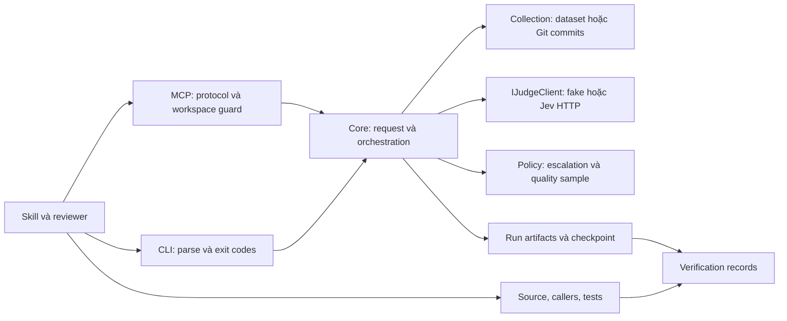

# Thiết kế Jev Review cho cộng đồng

Ngày: 14/10/2026. Trạng thái: **đề xuất để duyệt**, chưa triển khai kiến trúc mới. Căn cứ: [review kỹ thuật](../../community-review-2026-10-14.md) và nội dung System One/State/Primitives người dùng cung cấp, đối chiếu tài liệu chính thức.

## Mục tiêu và phạm vi

Người dùng muốn công cụ .NET được review nghiêm túc, có thể cài vào project khác, mở rộng và đóng góp như các công cụ hỗ trợ coding agent. Thành công của bản đầu là một người mới cài bản local package vào repo trống, chạy offline mà không cần cấu trúc thư mục lab, rồi gọi cùng pipeline qua MCP. Công cụ tiếp tục phân loại các thay đổi được mô tả là refactor và hỗ trợ reviewer xác minh.

Giả định thiết kế: ưu tiên developer tooling; chưa xây SDK tổng quát cho refund/ticket hay hệ thống orchestration nhiều agent. Hướng dẫn dùng bản hiện tại được cung cấp riêng và không trình bày lệnh tương lai như lệnh đã tồn tại.

## Ba hướng khả thi

| Hướng | Đánh đổi |
| --- | --- |
| **Core + .NET tool + MCP mỏng — đề xuất** | Dùng lại code và kiểm thử; cài theo project; cần tách contract và đóng gói assets |
| Giữ console app, phân phối zip publish | Ít thay đổi nhất; người dùng phải quản lý paths/config thủ công; dùng ngay qua installation guide |
| SDK System One tổng quát + nhiều workflow | Phạm vi rộng, đụng SDK cộng đồng hiện có; tăng compatibility matrix; hoãn đến khi có nhu cầu thật |

## Ranh giới thành phần

| Project/asset dự kiến | Trách nhiệm |
| --- | --- |
| `src/JevReview.Core` | Models review, request validation, collection, runner, policy, reporting, judge interface/implementations |
| `src/JevReview.Cli` | Composition, parser CLI, doctor, exit codes, MCP stdio adapter |
| `tests/JevReview.Tests` | Core regressions và integration CLI/MCP/package |
| Rubric/policy assets được đóng gói | Defaults đã version hóa, không dựa vào CWD |
| Skill phân phối kèm tool | Workflow rubric-first, đọc summary trước, xác minh bằng evidence |
| Evaluator | Giữ entry point hiện có; tách môi trường gold khi benchmark |

Giữ MCP trong CLI ở bản đầu để tránh một package/server cần cài riêng. `ReviewService` chuyển vào core, nhận request có kiểu, không nhận `CommandOptions`. CLI và MCP chỉ map input vào request đó. Core không đọc `Console`, không tự đọc API key từ environment; host cung cấp dependencies và credential khi live được cho phép.

## Contract và mở rộng

Request phải biểu diễn đúng một nguồn: dataset path hoặc Git range với base/head/task/merge-base. Dùng `ReviewRequest` và `ReviewSource` có kiểu; `RunOptions` giữ cấu hình execution. Signature mục tiêu của service: `Task<ReviewRun> StartAsync(ReviewRequest request, CancellationToken cancellationToken)`. Signature chi tiết của constructors và dependency injection sẽ được khóa trong implementation plan sau khi spec được duyệt.

`IJudgeClient.JudgeAsync(ReviewItem, ReviewRubric, CancellationToken)` là điểm mở rộng provider hiện hữu. Lần tách đầu giữ signature này. Mỗi provider sở hữu request serialization và byte budget của chính nó; tránh runner gọi static method của Jev. Không load assembly plugin tùy ý từ repo đang review.

Giữ bốn nhãn hiện tại và terminal states `classified`, `unjudged`, `excluded`. Prediction tiếp tục tách khỏi verification `confirmed`, `rejected`, `unresolved`. Wire artifacts hiện hữu không đổi tên field chỉ vì tách assembly. Thêm version trước khi thay format; đọc version cũ bằng adapter được test hoặc từ chối bằng error code cụ thể, không tự chấp nhận dữ liệu chưa hiểu.

## State và primitives

State review gồm mục tiêu thay đổi, path, diff và context; reviewer lấy thêm implementation/caller khi cần. V1 giữ một `choice` với bốn nhãn cho mỗi item. Không dùng Jev để sinh giải thích hay sửa code.

Noul cho tín hiệu có/không và Score cho mức độ có thứ tự là hướng mở rộng riêng, sau khi contract và benchmark đã ổn. Nhiều câu hỏi độc lập trên cùng state không phải bằng chứng độc lập thống kê; không nhân xác suất các câu để tạo một con số “an toàn”. Không gộp nhiều file không liên quan vào state chỉ để giảm số HTTP requests. Căn cứ: [Primitives](https://docs.typesafe.ai/primitives).

## Cài đặt và configuration mục tiêu

Đóng gói CLI thành .NET tool theo [hướng dẫn Microsoft](https://learn.microsoft.com/en-us/dotnet/core/tools/global-tools-how-to-create). Package ID đề xuất `JevReview.Tool`, command `jev-review`; cần kiểm tra quyền sở hữu tên trước khi publish. Cài theo local tool manifest để pin version, dùng `dotnet tool restore` trong repo người dùng. Gói core public là mốc sau, chưa cần publish cùng tool đầu tiên.

Tool chạy trên .NET 10; build giữ SDK `10.0.303`, `latestPatch`. Review repo .NET 8/9 không yêu cầu retarget repo đó, nhưng máy chạy tool cần .NET 10 runtime/SDK. Chưa cam kết core NuGet chạy trên .NET 8; nếu có nhu cầu, tạo plan multi-target và CI riêng.

Thứ tự cấu hình: option tường minh → config project → default được đóng gói. Lệnh `init` mục tiêu tạo `.jev-review/config.json` và rubric/policy theo project; mặc định từ chối ghi đè file có sẵn, hỗ trợ xem thay đổi trước khi áp dụng. API key chỉ từ environment hoặc cơ chế secret do host cung cấp khi live. Không viết key vào config.

Installer chỉ sửa file do nó sở hữu. Không tự ghi đè AGENTS.md, tool manifest, config Codex hay skill cùng tên. Nếu tạo integration cần file marker/ownership và backup; uninstall chỉ gỡ phần được quản lý. Bản đầu xuất cấu hình MCP để người dùng xem/copy; không sửa user-global config ngầm.

## Lỗi, persistence và MCP

Sửa Git literal pathspec và workspace root guard trước packaging. MCP validate initialize và trạng thái sẵn sàng theo protocol `2025-06-18`; stdout chỉ có JSON-RPC. Giới hạn 4 jobs đang chạy và concurrency mỗi job giữ defaults hiện tại. Thêm trạng thái/error code có cấu trúc cho job thất bại; không trả exception message, request body hay HTTP body.

Checkpoint lưu terminal verdict đã có và state của run; final artifacts ghi vào file tạm rồi rename, manifest completion ghi sau cùng theo cách atomic. Ngắt kết nối bình thường hủy và chờ jobs checkpoint trong budget có giới hạn. Kill cứng được đánh dấu incomplete/interrupted khi đọc lại; items chưa có terminal được hiển thị pending/unjudged, chưa được coi completed. In-memory terminal cache có giới hạn; lịch sử đĩa còn nguyên.

Tổng input budget phải được định nghĩa riêng với `MaxInputBytes` mỗi request. Input quá lớn có record lý do và flagged, không cắt diff âm thầm. Không build/test mã PR không tin cậy trong môi trường giữ key. OS sandbox/container là ranh giới riêng; path guard không thay thế nó.

## Roadmap và tiêu chí hoàn thành

| Mốc | Công việc | Gate kiểm chứng |
| --- | --- | --- |
| C1: Correctness | Sửa R1–R3, bổ sung regression đúng lỗi | Bracket chỉ 1 file/item; linked roots bị từ chối; handshake đúng; suite offline pass |
| C2: Core boundary | Tách core, typed request, provider budget | Tests tham chiếu core; CLI/MCP vẫn cùng verdict/counts; không phụ thuộc parser CLI |
| C3: Local distribution | Tool package, bundled defaults, config/init và doctor | `dotnet pack` → install từ local feed vào repo trống → doctor/classify/MCP pass, không cần lab CWD |
| C4: Long-running host | Checkpoint, atomic publish, bounded terminal cache, shutdown | Restart/kill/disconnect tests giữ trạng thái và đủ item, reads không thấy artifact dở |
| C5: Community release | License do chủ repo chọn, English quickstart, changelog, release CI, contribution guide | Windows/Linux package smoke; no secrets; package/license metadata khớp repo; checklist release được duyệt |
| C6: Evidence | Live smoke và A/B blind evaluation được phép riêng | Báo recall, false negatives, escalation, coverage, latency, chi phí đo được và N/A khi thiếu |

Sau khi duyệt spec, viết implementation plan riêng cho C1–C3 với file paths, signatures và assertions chính xác. C4/C5 có plan riêng để không trộn cải tiến persistence lớn vào thay đổi đóng gói. C6 cần môi trường evaluation và chi phí đã được chấp thuận; fake không thay gold.

## Lợi ích dự kiến và giới hạn

Công cụ giúp team có workflow triage lặp lại, policy rõ, traceable input/rubric/config và evidence sau xác minh. Khả năng giảm lượng context phải đọc hoặc tiết kiệm thời gian/chi phí cần đo; không đưa tỷ lệ quảng cáo chưa có benchmark. So sánh theo nhiệm vụ ở [comparison.md](../../comparison.md).

Thiết kế không yêu cầu framework orchestration, dashboard hoặc dependency ứng dụng người dùng. Core package và System One SDK tổng quát chỉ xây khi có consumer cụ thể. Repository chưa có license; không tự chọn quyền phân phối thay chủ repo.
